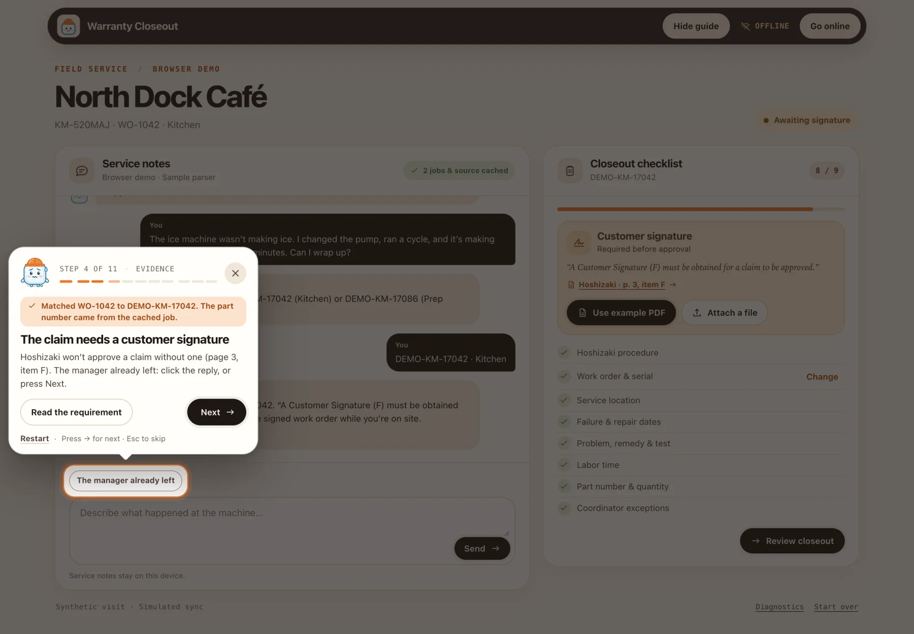

# Offline Warranty Closeout

A field-service assistant that catches a missing customer signature while the technician is still on site. It ties the repair to the right machine and verifies the Salesforce handoff after reconnecting.

**[Start the guided demo](https://guhanp09.github.io/offline-warranty-closeout/)** · [Watch the 75-second Salesforce walkthrough](https://guhanp09.github.io/offline-warranty-closeout/walkthrough/)

About 2 minutes. No install or sign-in. The demo uses sample data and simulated sync.

[](https://guhanp09.github.io/offline-warranty-closeout/)

In the demo, you’ll identify one of two same-model machines, reload an offline draft that’s awaiting a signature, and recover from a lost sync response.

## Results

- **Live Salesforce.** After an intentionally dropped response, retry found the same closeout and one signed PDF on the correct Work Order. [Read-back evidence](docs/evaluation.md#live-salesforce-read-back)
- **On-device model.** Qwen3 4B passed 41 / 41 repair extraction checks and selected 12 / 12 correct next actions. Median inference was 2.62 s across 16 warm turns on Apple M1 Pro. [Evaluation](docs/evaluation.md)

The Mac build uses Whisper for push-to-talk. The controlled offline test blocks IPv4 and IPv6 egress, restarts the app twice, and checks that the saved draft and approved outbox survive. [Reproduce the checks](docs/evaluation.md) · [GitHub Actions](https://github.com/guhanp09/offline-warranty-closeout/actions/workflows/ci.yml)

## Run on Apple silicon

Use a Mac with native Node 24.13+ in the Node 24 series and Homebrew. You can install Node with `brew install node@24` and add `$(brew --prefix node@24)/bin` to your PATH. The first setup installs Ollama, FFmpeg and whisper.cpp as needed, and downloads about 2.7 GB of models. The app serves its interface and inference through loopback.

```sh
git clone https://github.com/guhanp09/offline-warranty-closeout.git
cd offline-warranty-closeout
npm run setup
npm start
```

Open **http://127.0.0.1:4173**. In **Push to talk**, allow microphone access, press again to stop, then edit or send the locally transcribed note. `npm run demo` starts the local sample mode with no model download. To read and write real Work Orders and Files, deploy to a personal Salesforce development org. [Salesforce setup](docs/salesforce.md) · [Live demo script](docs/demo.md)

## How it works

- **Prepare online.** Cache the two Work Orders, Asset serials and the versioned Hoshizaki passage index.
- **Close out offline.** The model proposes typed observations. Deterministic checks bind them to the confirmed unit, look up the source, require the signed work order and record the technician’s attestation.
- **Approve and sync.** Preview and approve the exact fields and evidence. SQLite saves the frozen payload. Salesforce creates the closeout and file together. Retries find the unique key and verify the linked file’s SHA-256 before the app says **Synced**.

The workflow covers one Hoshizaki parts-and-labor case. The warranty coordinator decides what to submit. Chat stays on the device. [Architecture and privacy](docs/architecture.md) · [Supported policy and exceptions](docs/policy.md) · [EdgeChat handoff](docs/edgechat.md) · [Pilot protocol](docs/pilot.md)

## Repository

| Path | Contents |
| --- | --- |
| [app/](app/) | Browser interface, local workflow and Node server |
| [salesforce/](salesforce/) | Deployable closeout metadata, Work Order relationship and layout |
| [fixtures/](fixtures/) | Same-model visit, versioned passages and synthetic signed PDFs |
| [tests/](tests/) · [evals/](evals/) | Regression tests, labeled conversations and observed results |
| [scripts/](scripts/) | Mac setup, blocked-egress verification and Salesforce commands |

```sh
npm test
npm run check:offline
npm run eval
```
