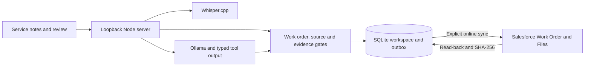

# Architecture

## Local conversation

The on-device model extracts submitted observations into the `update_draft` contract. The runtime runs `lookup_work_orders` against the cached visit and `retrieve_procedure` against a passage map indexed by workflow, version and passage key. The model receives previous fields as conversation context. It can propose repair observations and a signature exception. Work Order binding uses references in the technician’s note or their chosen serial. The validation layer decides the next question and whether a draft can be approved.

The SQLite workspace saves conversation state, indexed passages, provenance, the attachment and the outbox. A compare-and-swap revision prevents a stale tab from overwriting another turn. Approval writes a frozen payload and outbox state in one SQLite mutation with full synchronous journaling. The file digest ties the approved payload to the stored document.

The public preview has the same interface and rules with a small sample parser, browser storage, precached static assets and a simulated destination. Its own title and sync UI identify that mode.

## Salesforce transfer

The adapter first looks for the device-generated unique external key. For a new submission, it checks the Work Order, Asset and Account revisions against the approved snapshot. Salesforce validation rules check the revision fields again when the closeout is created. A Composite API request creates the closeout and its first `ContentVersion` together. `FirstPublishLocationId` links the file to the closeout. The unique key prevents a concurrent create from winning twice, and Salesforce rolls back a losing request. [External IDs](https://developer.salesforce.com/docs/platform/api-rest/guide/dome-upsert.html) · [Composite rollback](https://developer.salesforce.com/docs/platform/api-rest/guide/requests-composite.html) · [ContentVersion](https://developer.salesforce.com/docs/platform/object-reference/references/standard-objects/object-contentversion.html)

Every retry starts with read-back. It verifies the remote closeout identity, Work Order, payload digest, linked evidence version count and SHA-256 of the downloaded file. A remote conflict, changed job or stale source prevents unverified data from displaying as synced.

## Data boundary

Microphone bytes pass only between the local browser and loopback server. Local transcription uses temporary files that are removed when the request finishes. Conversation history stays in the workspace database. The browser shows the exact fields and signed document approved for transfer. Sync sends those fields and evidence to the configured development org. Authentication is managed by Salesforce CLI.

Diagnostics capture model and prompt version, latency, source reference, counts, validation keys and sync outcomes. The workspace SQLite file is local plaintext with user-only permissions. Use synthetic material for the demo and your organization's device protection policies for future pilots.
